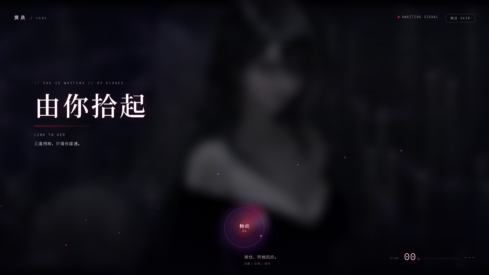
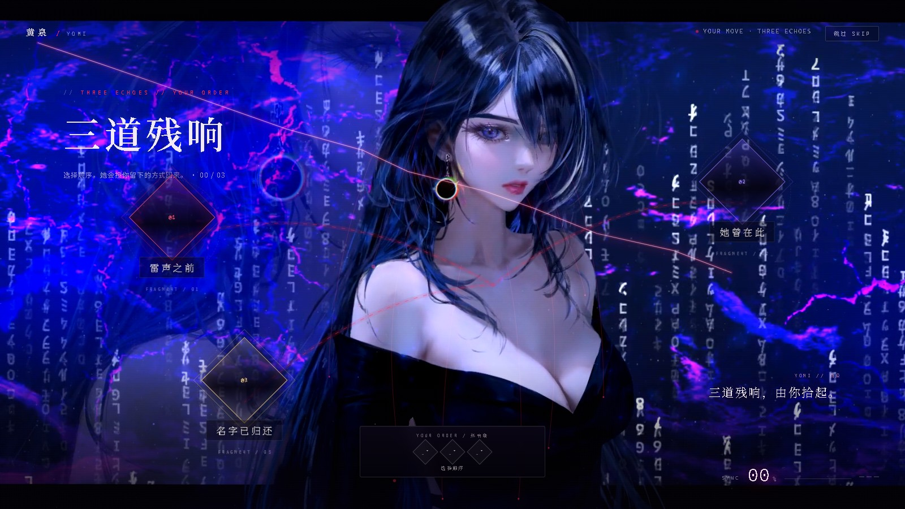
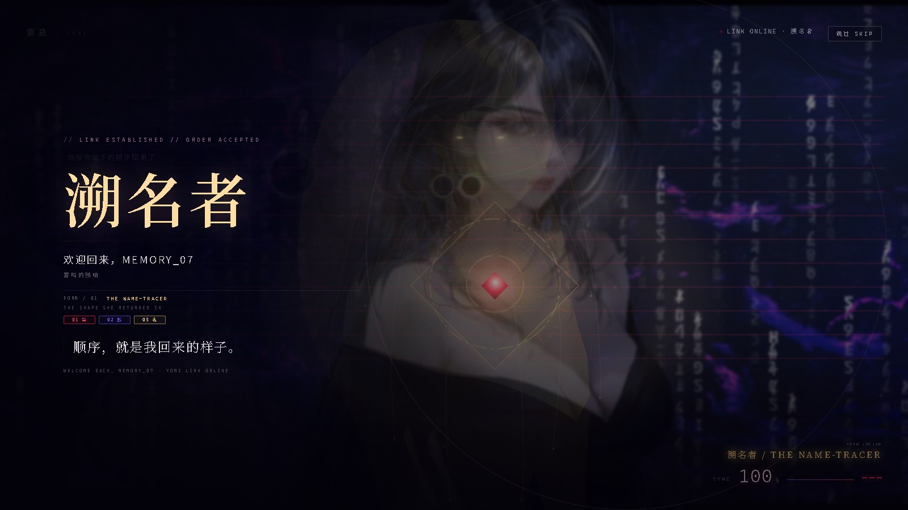

# dsh-startup-yomi · 黄泉启动序列

[](https://github.com/QIFANAI/dsh-startup-yomi/actions/workflows/ci.yml)
[](https://github.com/QIFANAI/dsh-startup-yomi/releases)
[](LICENSE)

> DeepSeek Harness 的启动序列插件。0.3.2「由你拾起」把主动交回给观看者：
> 不是播片，是一枚要按住的核心、三道任意顺序的残响、一个由顺序决定的她。
> **三道残响，由你拾起。顺序，就是我回来的样子。**

当前版本 **0.3.2**。插件零运行时依赖，web profile 与 DeepSeek Harness Desktop 通用。



| 残响层（顺序定型） | 揭幕 |
|---|---|
|  |  |

## 安装

### 推荐：从 Release 安装（固定版本 + 校验）

先**完全退出** DeepSeek Harness（桌面端连托盘图标一起关，profile 由 Electron 独占）。
然后下载安装器，先 dry-run，再安装：

```powershell
Invoke-WebRequest -Uri "https://raw.githubusercontent.com/QIFANAI/dsh-startup-yomi/v0.3.2/scripts/install.mjs" -OutFile "install-yomi.mjs"
node install-yomi.mjs --profile desktop --version 0.3.2 --dry-run
node install-yomi.mjs --profile desktop --version 0.3.2
```

macOS / Linux：

```bash
curl -fL "https://raw.githubusercontent.com/QIFANAI/dsh-startup-yomi/v0.3.2/scripts/install.mjs" -o install-yomi.mjs
node install-yomi.mjs --profile desktop --version 0.3.2 --dry-run
node install-yomi.mjs --profile desktop --version 0.3.2
```

安装器只下载 GitHub Release 资产，不执行远程脚本；它会核对 `release.json`、
`SHA256SUMS` 与文件大小，再把 tgz 交给 `dsh plugin`。

### 手动安装

从 [Releases](https://github.com/QIFANAI/dsh-startup-yomi/releases) 下载
`dsh-startup-yomi-0.3.2.tgz` 与 `SHA256SUMS`，校验后执行：

```bash
dsh plugin --profile desktop add ./dsh-startup-yomi-0.3.2.tgz
dsh plugin --profile desktop list
```

web profile 把 `desktop` 换成 `web`。如果终端找不到 `dsh`，用安装器参数
`--dsh <dsh 可执行文件>` 指定，或把 DSH 的 bin 目录加入 `PATH`。

安装完成后重新启动 DSH。设置页应出现 **设置 → 黄泉启动序列**，顶部版本号为 `0.3.2`。
完整步骤与排错见 [INSTALL.md](INSTALL.md)。

### 从源码安装（开发）

```bash
git clone https://github.com/QIFANAI/dsh-startup-yomi.git
cd dsh-startup-yomi
npm test
dsh plugin --profile desktop add link:$PWD
```

Windows 下把 `$PWD` 换成仓库绝对路径。源码安装改完 `lib/*` 刷新客户端即生效；
Host 半侧按文件 mtime 缓存，不需要重新打 tgz。

## 安装结果与声画素材

官方 Release 的**插件代码与安装包对所有用户逐字节一致**：同一版本、同一文件清单、
同一 SHA-256。第三方角色视频、商业 BGM 与揭幕语音因授权边界**不随仓库或官方 Release
分发**，所以官方包默认走 Canvas + WebAudio 的完整降级链，不会缺功能、不会报错。

如果你有权使用相应素材，把它们放进 `lib/assets/`，再执行：

```bash
npm run build:full
```

产物 `releases/dsh-startup-yomi-0.3.2-full.tgz` 只供本机验证与自用，**不要上传**。
素材规格与准备脚本见 [lib/assets/README.md](lib/assets/README.md)。

## 序列

| 幕 | 画面 | 交互 |
|---|---|---|
| DORMANT | 黑场、信号线扫过、低频下潜 | 无 |
| LINK | 角色母版从虚焦去饱和里随蓄能显影，中央一枚小核心 | **按住**鼠标 / Space / Enter 蓄力 1.8s |
| ECHO | 三枚菱形残响碎片浮出，角色出场并回应第一句 | **任意顺序**点击三枚；先后顺序决定最终形态 |
| SYNC | 环塌缩、色散、过曝 | 无 |
| REVEAL | 形态名 + 欢迎语 + 第二句台词 + 本次残响谱 | 无（Esc / 右上 SKIP 随时跳过） |

与传统「五步依次确认」不同，**残响碎片是非线性的**：三次点击可以任意排列，
但先后顺序会被记进残响谱，并决定她最终以哪种形态回来。六种排列对应六种结局；
每枚碎片仍是独立的雷击 + 打字机日志 + SYNC 百分比。完整档静置 6.5 秒只会把提示
改成「她还在等」，**不会自动退出**；只有宿主侧 `splash.js` 根本没有启动时，
8 秒看门狗才会放行，避免黑屏锁死。

## 六种顺序形态

| 点击顺序 | 形态 | 本体变化 |
|---|---|---|
| 雷 → 影 → 名 | 溯名者 | 近景、金色胸印与轮廓线 |
| 雷 → 名 → 影 | 执灯者 | 人物略抬，头后月白光环展开 |
| 影 → 雷 → 名 | 归雷者 | 宽景、左右双影退开、持续落雷 |
| 影 → 名 → 雷 | 拾忆者 | 人物左收，向右拖出三层冷蓝残影 |
| 名 → 雷 → 影 | 问名者 | 右侧镜像出现，镜面缝成为画面中轴 |
| 名 → 影 → 雷 | 余响者 | 人物停正中，左右四层对称回声 |

揭幕页左侧会同时写出形态名、英文别名与本次点击顺序；右下的小字保留
`FORM / 0N` 与 `SYNC 100%`，作为可回看的证据层。

## 配置（18 项）

设置页 **设置 → 黄泉启动序列**：

| 分组 | 选项 | 默认 | 说明 |
|---|---|---|---|
| 播放 | 启用 | 开 | 总开关 |
| 播放 | 显示模式 | 每次会话 | 每次会话 / 总是 / 每天 |
| 播放 | 速度 | 1× | 0.6 – 2.0 |
| 播放 | 交互强度 | 完整 | `完整` 按住 + 三碎片；`快速` 单击接入；`关闭` 纯播放 |
| 播放 | 允许跳过 | 开 | 右上 SKIP 与 Esc |
| 角色 | 身份名称 | `OPERATOR` | 揭幕第二行「欢迎回来，<身份>」 |
| 角色 | 称号 | 雷鸣的残响 | 身份下方的小字 |
| 角色 | 残响文案 | 雷声之前\|她曾在此\|名字已归还 | 三枚碎片文案，`\|` 分隔 |
| 视觉 | 主色 | `#ff2d55` | 电光红 |
| 视觉 | 副色 | `#7a5cff` | 残响紫 |
| 视觉 | 扫描线 | 开 | 叠在母版上的细扫描线 |
| 视觉 | 故障强度 | 0.6 | 揭幕色散/抖动强度 |
| 声音 | 动态母版 | 开 | 优先 `hero-loop.mp4`；解码失败回退 `hero-loop.webm`，再 `hero.mp4`；都失败仍保留静态海报角色 |
| 声音 | BGM | 开 | 循环播放，揭幕语音进入时压低 |
| 声音 | BGM 音量 | 35% | |
| 声音 | 音效 | 开 | WebAudio 现场合成，不依赖素材 |
| 声音 | 音效音量 | 60% | |
| 播放 | 减弱动态 | 关 | 保留母版视频的连续运动；关闭整幅位移、残影、雷暴与抖动（也尊重系统 `prefers-reduced-motion`） |

配置文件：`~/.dsh/dsh-startup-yomi.json`。DSH 退出时会写回；手改请在 DSH 关闭状态下进行。

## 兼容性

- DeepSeek Harness Desktop（`desktop` profile）与 web profile 通用。
- Node.js `>= 20`（插件本身零依赖；安装器与构建脚本需要 Node）。
- 主要在 Windows 11 + Edge/Electron 上验证；macOS/Linux 的安装链路由 CI 覆盖，动画未做逐帧实机验收。

## 开发

```bash
npm test                  # 宿主路由 + 浏览器侧契约
npm run check             # 公开仓库门禁：隐私路径、媒体、版本、断链
npm run build             # 可复现 source 包 → releases/
npm run build:full        # 本机完整声画包（不要上传）
npm run verify:release    # 重建 source 包并与 release.json 比对
```

干净克隆没有第三方素材时，测试会跳过素材相关用例（`smoke-host` 29 项、
`smoke-splash` 133 项）；本机带素材时是 39 + 145 项。两者都必须 PASS。

独立预览：直接双击 `preview/index.html`，或访问 `/dsh-yomi/preview`。
`?phase=link|echo|reveal` 可停在某一幕，`?novideo=1` 验证无素材回落，
`?clean=1` 隐藏调试条，`?order=1-2-3` 等参数可直达六种终帧。

## 目录

```text
├─ lib/                  插件源码：Host 路由、设置页、启动序列、素材占位
├─ test/                 两套冒烟测试
├─ preview/              离线预览
├─ docs/screenshots/     README 配图
├─ scripts/              构建、校验、安装器、素材准备、截图
├─ .github/              CI、Release、Issue/PR 模板
├─ release.json          当前 Release 的版本、大小与哈希（不进 npm 包）
└─ releases/             本地构建产物（gitignore）
```

## 素材、商标与致谢

- 代码 MIT；影音素材不随仓库或官方 Release 分发，边界见 [THIRD-PARTY-NOTICES.md](THIRD-PARTY-NOTICES.md)。
- 本项目是社区作品，与 DeepSeek / 深度求索无隶属关系，未获官方背书。
- 上游插件 `dsh-startup-screen` 由 **沈宏宏** 以 MIT 发布；本仓库保留原始版权声明并继续修改。

## License

[MIT](LICENSE) © 2026 沈宏宏（原始版本）与 dsh-startup-yomi contributors（修改）
